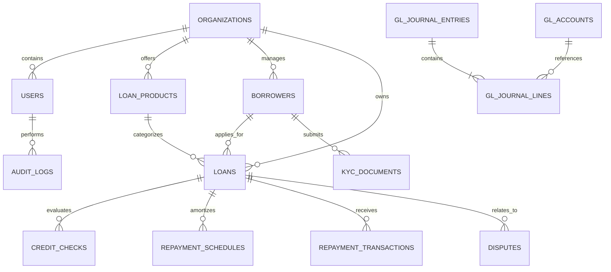

# Loan Management System — Database Schema Design

This database schema is designed for **PostgreSQL / Microsoft SQL Server** with high financial precision (`DECIMAL(18,4)`), strict multi-tenant scoping (`organization_id`), and complete double-entry ledger tracking.

---

## 1. Relational Entity Relationship Diagram

---

## 2. Table Definitions

### 1. `organizations` (Multi-Tenancy)
| Column | Type | Constraints | Description |
|---|---|---|---|
| `id` | VARCHAR(50) | PRIMARY KEY | Unique Org ID (e.g. `org_1`) |
| `name` | VARCHAR(150) | NOT NULL | Institution or Bank Name |
| `created_at` | TIMESTAMPTZ | NOT NULL DEFAULT NOW() | Record creation time |
| `is_active` | BOOLEAN | NOT NULL DEFAULT TRUE | Tenant status |

---

### 2. `borrowers`
| Column | Type | Constraints | Description |
|---|---|---|---|
| `id` | VARCHAR(50) | PRIMARY KEY | Unique Borrower ID (e.g. `bor_9011`) |
| `organization_id` | VARCHAR(50) | NOT NULL, FK(`organizations.id`) | Tenant ID |
| `first_name` | VARCHAR(100) | NOT NULL | First Name |
| `last_name` | VARCHAR(100) | NOT NULL | Last Name |
| `email` | VARCHAR(255) | NOT NULL | Contact Email |
| `phone_number` | VARCHAR(50) | NOT NULL | Contact Phone |
| `national_id_hash` | VARCHAR(256) | NOT NULL | Hashed Government ID (SSN/National ID) |
| `kyc_status` | VARCHAR(50) | NOT NULL DEFAULT 'Pending' | `Pending`, `Verified`, `Rejected` |
| `monthly_income` | DECIMAL(18,4) | NOT NULL | Verified Monthly Income |
| `created_at` | TIMESTAMPTZ | NOT NULL DEFAULT NOW() | |

---

### 3. `loan_products`
| Column | Type | Constraints | Description |
|---|---|---|---|
| `id` | VARCHAR(50) | PRIMARY KEY | Product ID (e.g. `prod_personal_01`) |
| `organization_id` | VARCHAR(50) | NOT NULL, FK(`organizations.id`) | Tenant ID |
| `name` | VARCHAR(100) | NOT NULL | Product Title |
| `base_interest_rate` | DECIMAL(8,4) | NOT NULL | Annual Interest Rate (e.g. 12.5000) |
| `min_amount` | DECIMAL(18,4) | NOT NULL | Minimum borrowing limit |
| `max_amount` | DECIMAL(18,4) | NOT NULL | Maximum borrowing limit |
| `min_tenor_months` | INT | NOT NULL | Minimum loan term |
| `max_tenor_months` | INT | NOT NULL | Maximum loan term |
| `origination_fee_pct` | DECIMAL(5,2) | NOT NULL DEFAULT 0.00 | Fee percentage |
| `late_fee_flat` | DECIMAL(18,4) | NOT NULL DEFAULT 0.00 | Flat fee for overdue |
| `is_active` | BOOLEAN | NOT NULL DEFAULT TRUE | Available for origination |

---

### 4. `loans` (Aggregate Root)
| Column | Type | Constraints | Description |
|---|---|---|---|
| `id` | VARCHAR(50) | PRIMARY KEY | Loan ID (e.g. `loa_1001`) |
| `organization_id` | VARCHAR(50) | NOT NULL, FK(`organizations.id`) | Multi-tenant ID |
| `borrower_id` | VARCHAR(50) | NOT NULL, FK(`borrowers.id`) | Borrower reference |
| `product_id` | VARCHAR(50) | NOT NULL, FK(`loan_products.id`) | Product reference |
| `status` | VARCHAR(50) | NOT NULL | `Draft`, `Submitted`, `Underwriting`, `Approved`, `Disbursed`, `Active`, `Delinquent`, `Closed` |
| `requested_amount` | DECIMAL(18,4) | NOT NULL | Principal applied for |
| `approved_amount` | DECIMAL(18,4) | NULL | Principal approved |
| `disbursed_amount` | DECIMAL(18,4) | NULL | Amount transferred to borrower |
| `currency` | VARCHAR(3) | NOT NULL DEFAULT 'USD' | ISO Currency |
| `interest_rate` | DECIMAL(8,4) | NOT NULL | Annual interest rate applied |
| `tenor_months` | INT | NOT NULL | Term in months |
| `outstanding_principal`| DECIMAL(18,4) | NOT NULL DEFAULT 0.00 | Remaining unpaid principal |
| `accrued_interest` | DECIMAL(18,4) | NOT NULL DEFAULT 0.00 | Interest accumulated to date |
| `disbursed_at` | TIMESTAMPTZ | NULL | Date & time funds released |
| `first_repayment_date`| DATE | NULL | Date first installment due |
| `approved_by` | VARCHAR(50) | NULL | Underwriter User ID |
| `concurrency_token` | ROWVERSION / INT | NOT NULL DEFAULT 1 | Optimistic locking token |
| `created_at` | TIMESTAMPTZ | NOT NULL DEFAULT NOW() | |
| `updated_at` | TIMESTAMPTZ | NULL | |

---

### 5. `repayment_schedules` (Amortization Installments)
| Column | Type | Constraints | Description |
|---|---|---|---|
| `id` | BIGINT | PRIMARY KEY IDENTITY/SERIAL | Installment ID |
| `loan_id` | VARCHAR(50) | NOT NULL, FK(`loans.id`) | Loan reference |
| `installment_number` | INT | NOT NULL | 1, 2, ... N |
| `due_date` | DATE | NOT NULL | Installment due date |
| `principal_due` | DECIMAL(18,4) | NOT NULL | Principal component |
| `interest_due` | DECIMAL(18,4) | NOT NULL | Interest component |
| `total_due` | DECIMAL(18,4) | NOT NULL | Principal + Interest |
| `remaining_principal` | DECIMAL(18,4) | NOT NULL | Balance after this installment |
| `status` | VARCHAR(50) | NOT NULL DEFAULT 'Pending' | `Pending`, `Paid`, `PartiallyPaid`, `Overdue` |
| `paid_date` | TIMESTAMPTZ | NULL | When settled |

---

### 6. `repayment_transactions` (Payments Received)
| Column | Type | Constraints | Description |
|---|---|---|---|
| `id` | VARCHAR(50) | PRIMARY KEY | Payment ID (e.g. `pmt_4001`) |
| `loan_id` | VARCHAR(50) | NOT NULL, FK(`loans.id`) | Loan reference |
| `organization_id` | VARCHAR(50) | NOT NULL | Tenant ID |
| `amount_paid` | DECIMAL(18,4) | NOT NULL | Total cash received |
| `principal_allocated` | DECIMAL(18,4) | NOT NULL | Allocated to reduce principal |
| `interest_allocated` | DECIMAL(18,4) | NOT NULL | Allocated to interest income |
| `late_fee_allocated` | DECIMAL(18,4) | NOT NULL DEFAULT 0.00 | Allocated to late fees |
| `payment_method` | VARCHAR(50) | NOT NULL | `BankTransfer`, `DirectDebit`, `Card`, `Cash` |
| `transaction_reference`| VARCHAR(100) | NOT NULL UNIQUE | Bank reference or payment gateway ID |
| `processed_at` | TIMESTAMPTZ | NOT NULL DEFAULT NOW() | |

---

### 7. `gl_accounts` & `gl_journal_entries` (Double-Entry Ledger)
**`gl_accounts`**:
- `account_number` (VARCHAR(50), PK - e.g. `1100-Cash`, `1200-LoansReceivable`, `4100-InterestIncome`)
- `account_name` (VARCHAR(100), NOT NULL)
- `category` (VARCHAR(50), NOT NULL: `Asset`, `Liability`, `Equity`, `Revenue`, `Expense`)

**`gl_journal_entries`**:
- `id` (VARCHAR(50), PK - e.g. `GL_ENT_9922`)
- `organization_id` (VARCHAR(50), NOT NULL)
- `accounting_date` (DATE, NOT NULL)
- `memo` (VARCHAR(255), NOT NULL)
- `created_at` (TIMESTAMPTZ, NOT NULL DEFAULT NOW())

**`gl_journal_lines`**:
- `id` (BIGINT, PK IDENTITY)
- `journal_entry_id` (VARCHAR(50), FK to `gl_journal_entries.id`)
- `account_number` (VARCHAR(50), FK to `gl_accounts.account_number`)
- `debit` (DECIMAL(18,4), NOT NULL DEFAULT 0.00)
- `credit` (DECIMAL(18,4), NOT NULL DEFAULT 0.00)

---

### 8. `idempotency_records`
| Column | Type | Constraints | Description |
|---|---|---|---|
| `idempotency_key` | VARCHAR(128) | PRIMARY KEY | Client-supplied header |
| `organization_id` | VARCHAR(50) | NOT NULL | Scoped to organization |
| `request_hash` | VARCHAR(64) | NOT NULL | SHA256 of endpoint + request body |
| `status_code` | INT | NOT NULL | HTTP status code (e.g. 200, 201) |
| `response_payload` | TEXT / JSONB | NOT NULL | Cached response body |
| `created_at` | TIMESTAMPTZ | NOT NULL DEFAULT NOW() | |
| `expires_at` | TIMESTAMPTZ | NOT NULL | Expiration timestamp (e.g. +48h) |

---

### 9. `audit_logs`
| Column | Type | Constraints | Description |
|---|---|---|---|
| `id` | BIGINT | PRIMARY KEY IDENTITY | Auto-increment log ID |
| `timestamp` | TIMESTAMPTZ | NOT NULL DEFAULT NOW() | UTC event time |
| `organization_id` | VARCHAR(50) | NOT NULL | Tenant ID |
| `actor_id` | VARCHAR(50) | NOT NULL | User who took action |
| `actor_role` | VARCHAR(50) | NOT NULL | Role of actor |
| `action` | VARCHAR(100) | NOT NULL | `LoanDisbursed`, `PaymentMade`, etc. |
| `entity` | VARCHAR(50) | NOT NULL | `Loan`, `Borrower`, etc. |
| `entity_id` | VARCHAR(50) | NOT NULL | Target Entity ID |
| `ip_address` | VARCHAR(45) | NULL | Client IP Address |
| `old_values` | TEXT / JSONB | NULL | Serialized state before change |
| `new_values` | TEXT / JSONB | NULL | Serialized state after change |

---

## 3. Recommended Indexes for Performance
1. `CREATE INDEX idx_loans_org_status ON loans(organization_id, status);`
2. `CREATE INDEX idx_loans_borrower ON loans(borrower_id);`
3. `CREATE INDEX idx_repayment_schedule_loan_status ON repayment_schedules(loan_id, status, due_date);`
4. `CREATE INDEX idx_gl_lines_entry ON gl_journal_lines(journal_entry_id);`
5. `CREATE INDEX idx_idempotency_lookup ON idempotency_records(idempotency_key, organization_id);`
