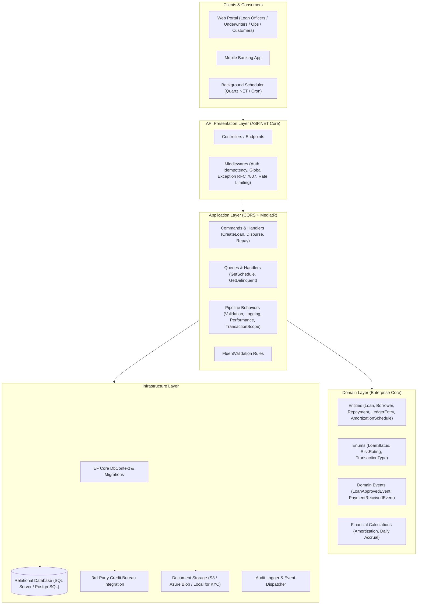
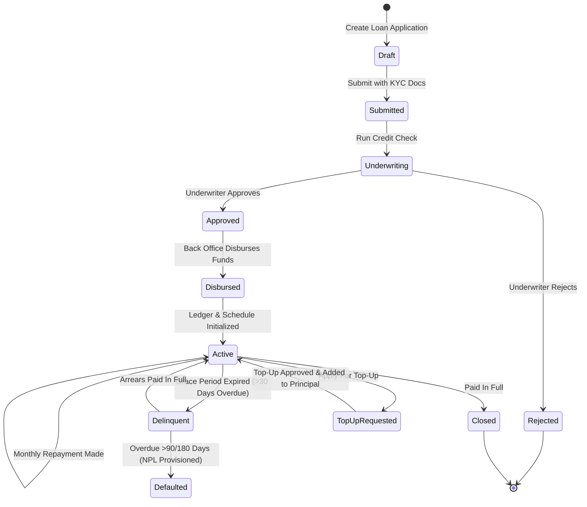
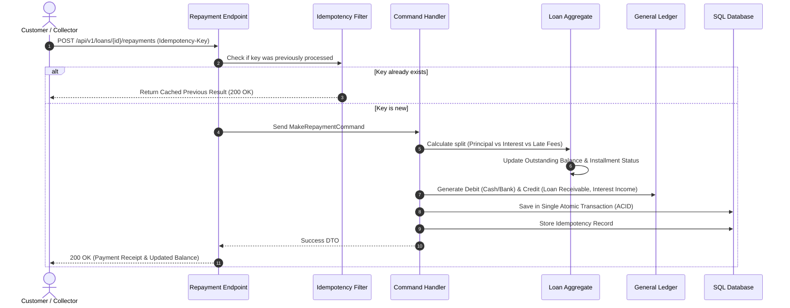

# Loan Management System — Diagrams & Architecture Flows

## 1. Clean Architecture System Overview

---

## 2. Complete Loan State Lifecycle (State Machine)

---

## 3. Financial Repayment & Double-Entry Ledger Flow

